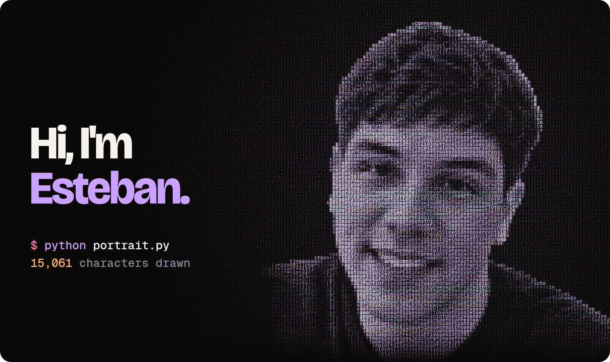
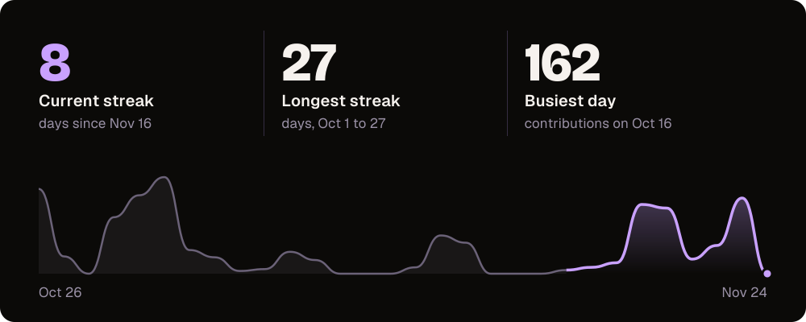

  <picture>
    <source media="(max-width: 600px)" srcset="assets/header-tall.webp">
    
  </picture>

> *Despite everything, it's still you.* (Undertale)

Almost everything I write lives in private repos, so the code you'll see most around here is my face. That portrait is built from the source of the script that draws it, and you can read it [right here](portrait.py).

  
  
  

### Problems I enjoyed

- Getting a desktop ERP to respond over a REST API without touching the ERP.
- Database-per-tenant multitenancy behind a single API. Every request resolves its tenant, gets a connection from that tenant's own pool and holds it for the whole transaction.
- Systems where "almost right" counts as wrong, with high volume, strict rules and a system on the other end rejecting anything that doesn't match exactly. They demand rigor in every detail and good judgment in how you design them.
- Getting several AI agents to work on the same codebase without stepping on each other.

### What I use at work

  
  
  
  
  
  
  
  
  
  
  
  
  
  
  
  
  
  
  
  
  
  
  
  
  
  
  

### Learning now

  
  
  
  
  
  

Python with Celery, LangChain, LangGraph and LangSmith, plus AWS.

### When I'm not coding

  <picture>
    <source media="(max-width: 600px)" srcset="assets/strip-tall.webp">
    
  </picture>

Manhwa, games and a painting of a man looking out at the fog. If you've read *Star-Embracing Swordmaster*, we already have something to talk about.

### Build something with me

I want to do more open source, and I also take on freelance work and join other people's projects. If you have an old issue nobody wants to pick up, or an idea that needs another pair of hands, send it my way.

   
  <picture>
    <source media="(max-width: 600px)" srcset="assets/streak-tall.svg">
    
  </picture>

